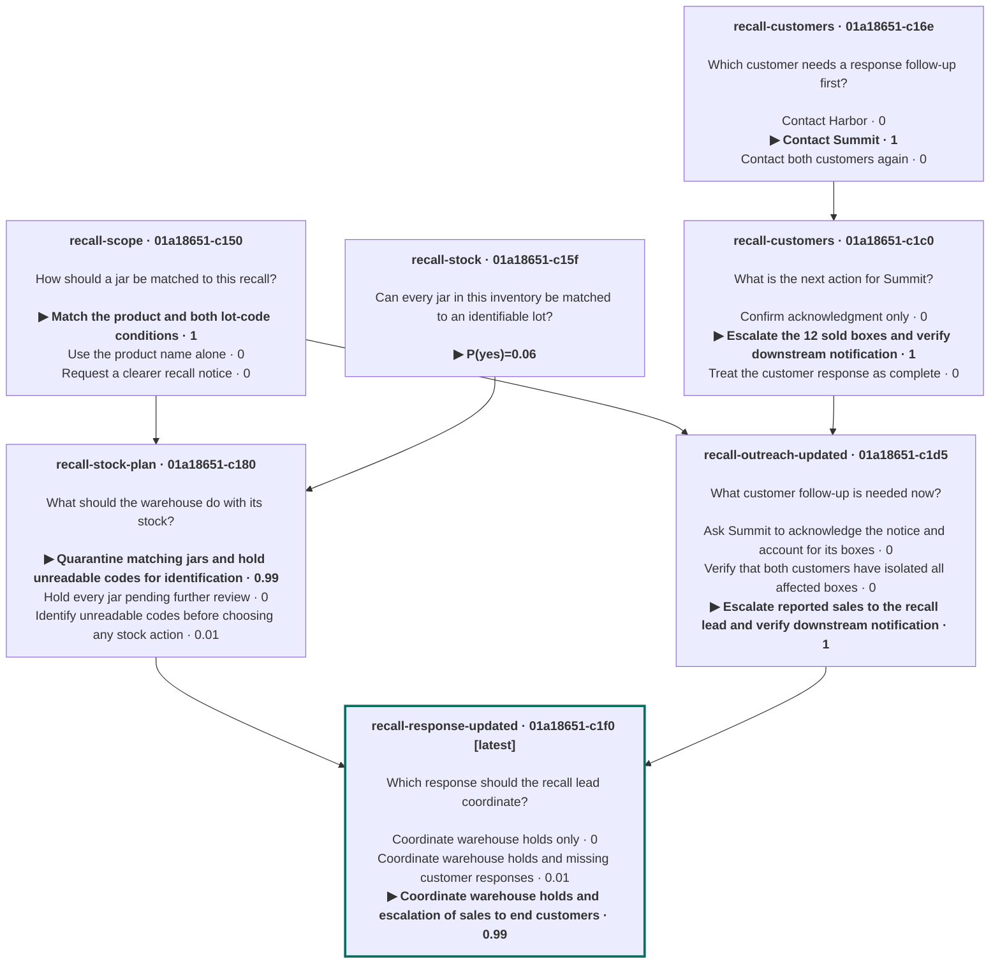

# Nouli

[](LICENSE)
[](rust-toolchain.toml)

**Nouli is a multi-turn decision harness: it runs decision models over many turns.**

A decision model doesn't write text. You give it facts and a question with a fixed set of answers, and it returns the answer it picks along with a probability. That makes it useful for real decisions, but each call is stateless. The model forgets everything once it answers.

Nouli adds the parts a single model call doesn't have, much as an agent harness wraps an LLM:

- **Memory across turns.** A session records every fact, question, and answer. When new information arrives, you add only that information, and the model decides with the whole history in view.
- **Typed answers.** Every question has a defined answer space: `choice` (pick an option), `noul` (probability of yes), or `score` (a position on an ordered rubric). Results are probabilities, not prose.
- **Branching and blending.** Start a new session from one history to explore an alternative, or combine several independent histories into one decision.
- **A durable record.** Sessions are stored locally, so you can trace any decision back to the facts and earlier answers it was based on.

Nouli ships as a CLI and a Rust library.

## Install

> Installation instructions are coming soon.

<!-- TODO: add install instructions (release downloads, cargo install) and provider setup. -->

## Example: a decision that changes when new facts arrive

A food distributor is handling a peanut butter recall. It shipped 30 affected snack boxes to each of two customers, Harbor and Summit. Below are two turns of the same session.

### Turn 1: start a session

Start a session named `recall`, add what is known so far, and ask a question:

```sh
nouli --name recall \
  --state 'Illustrative records at 09:30 on May 23, 2022: ingredient lot 1352425 was used
in 60 snack boxes, batch SNACK-A. Harbor received 30 and Summit received 30.
Harbor acknowledges the recall notice and confirms all 30 are isolated. Summit
has not responded. There were no other shipments of this batch.' \
  --questions '[{
    "id": "customers",
    "prompt": "Which customer needs a response follow-up first?",
    "answer_space": {
      "type": "choice",
      "options": [
        {"id": "harbor", "description": "Contact Harbor"},
        {"id": "summit", "description": "Contact Summit"},
        {"id": "both",   "description": "Contact both customers again"}
      ]
    }
  }]'
```

```text
Session: 01a1861e-4079-7001-a962-1d453b45ece1
Turn: 01a1861e-40ee-70bf-b345-ddf2e59f1a9f
Provider: typesafe/jev-1.14.0
customers: choice: summit (Contact Summit), P(selected)=1
```

Harbor has isolated its boxes and Summit hasn't replied, so the model picks Summit.

### Turn 2: add only what is new

Later that morning, Summit replies. Continue the same session with `--session`. You don't repeat the earlier facts because Nouli already has them:

```sh
nouli --session recall \
  --state 'Illustrative update at 11:00 on May 23, 2022: Summit has now acknowledged the
notice. It isolated 18 SNACK-A boxes and reports that 12 were already sold to
end customers. Whether those buyers have been notified is unknown. This
replaces the earlier Summit nonresponse. Harbor still has all 30 boxes
isolated.' \
  --questions '[{
    "id": "customers",
    "prompt": "What is the next action for Summit?",
    "answer_space": {
      "type": "choice",
      "options": [
        {"id": "confirm",  "description": "Confirm acknowledgment only"},
        {"id": "escalate", "description": "Escalate the 12 sold boxes and verify downstream notification"},
        {"id": "close",    "description": "Treat the customer response as complete"}
      ]
    }
  }]'
```

```text
Session: 01a1861e-4079-7001-a962-1d453b45ece1
Turn: 01a1861e-4360-7697-a44e-d944aa8c9675
Provider: typesafe/jev-1.14.0
customers: choice: escalate (Escalate the 12 sold boxes and verify downstream notification), P(selected)=1
```

The session ID is the same and the turn ID is new. The model decides using what it learned in turn 1: SNACK-A is the affected batch, Summit received 30 boxes, and Harbor's boxes are already isolated. The 12 boxes that reached end customers make escalation necessary. Turn 1 stays in the history, and you can inspect it at any time:

```sh
nouli view --session recall
```

These outputs come from a recorded run. Answers and probabilities depend on your model.

### Going further

The [full recall walkthrough](https://standing-desks.github.io/nouli/examples/recall/) keeps going. It records the recall scope and warehouse stock in separate sessions, then blends them into a coordinated response with `--from`. When Summit's reply arrives, it builds a revised response. Each walkthrough ends with the decision graph that `nouli view --mermaid` prints:



More [examples](https://standing-desks.github.io/nouli/examples/) cover robotic picking, seed investing, lending, credit limits, vulnerability response, and energy planning.

## Documentation

- [User guide](https://standing-desks.github.io/nouli/guide/): setup, sessions, branching, blending, and workflows
- [Configuration](docs/configuration.md): providers, models, credentials, and storage
- [CLI guide](docs/cli-evaluation.md): request files, sessions, branching, and blending
- [Question types](docs/contracts/decisions.md): `choice`, `noul`, and `score`
- [Output formats](docs/output.md): text, JSON, JSONL, and TOON
- [Workflows](docs/cli-workflows.md): dependent decisions and resuming interrupted runs
- [Rust library](docs/embedding.md): embed Nouli in your own application

## Contributing

```sh
cargo fmt --all --check
cargo clippy --workspace --all-targets --locked -- -D warnings
cargo test --workspace --locked
```

Tests use local fixture providers and don't need API keys. The website lives in [`site/`](site/README.md). See [AGENTS.md](AGENTS.md) for conventions and [docs/adr/](docs/adr/) for design decisions.

## License

[MIT](LICENSE)
