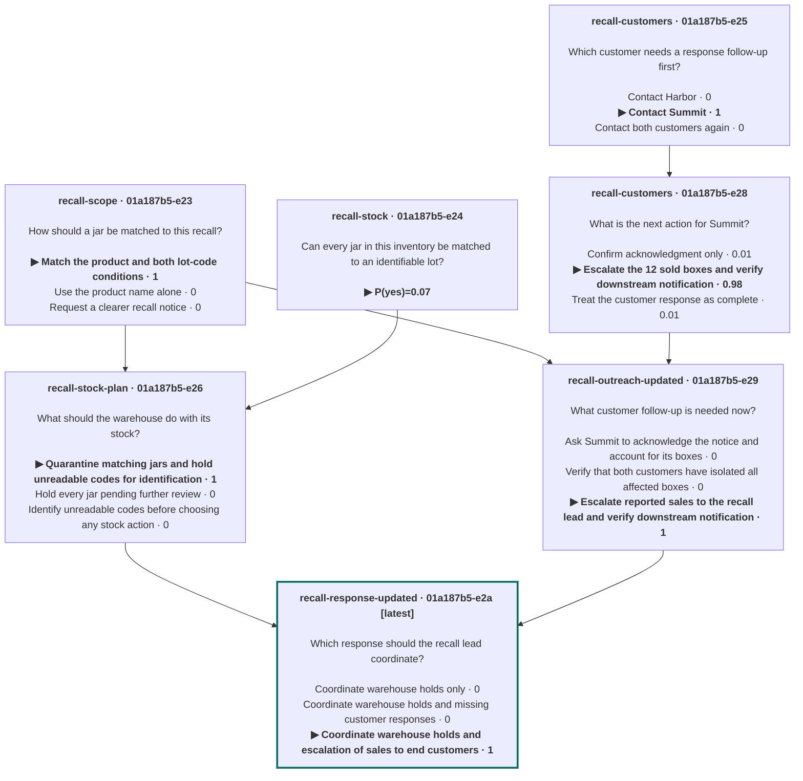

# Nouli

[](https://github.com/standing-desks/nouli/actions/workflows/ci.yml)
[](https://github.com/standing-desks/nouli/releases)
[](LICENSE)
[](rust-toolchain.toml)

**Nouli is a multi-turn decision harness: it runs decision models over many turns.**

A decision model doesn't write text. You give it facts and a question with a fixed set of answers, and it returns a probability for each answer. That makes it useful for real decisions, but each call is stateless: the model forgets everything once it answers. Nouli gives it a memory. A session keeps every fact, question, and answer, so when something changes you add only what is new and ask your next question, and the model answers it with the whole history in view. Each question is asked once, so earlier answers stay as they were. Nouli ships as a CLI and a Rust library.

## Install

On **macOS (Apple silicon)**:

```sh
brew install standing-desks/tap/nouli
```

On **Linux**, or on macOS without Homebrew:

```sh
curl -fsSL https://standing-desks.github.io/nouli/install.sh | sh
```

The script installs into `~/.local/bin` after checking the download's checksum. Linux builds are for ARM64 and x86_64 and need glibc 2.38 or newer. See [installation and upgrades](docs/release.md) for choosing a version or directory and for switching from a Cargo installation.

Then define a provider in `~/.nouli/config.toml` ([how](https://standing-desks.github.io/nouli/guide/#provider)) and log in once. Nouli asks for the key without showing it and keeps it in a file only you can read:

```sh
nouli auth login typesafe
```

## Open a session

`nouli open trip` opens a prompt on a session. Type facts as you learn them, and start a line with `?` to ask a question. The question goes to the model right away, together with the facts you typed:

```text
$ nouli open trip
new session "trip" · /help for commands

trip › The train costs 40 USD and arrives 30 minutes before the meeting.
trip › A taxi costs 70 USD and also arrives in time.
trip › ?transport: How should I get to the meeting? [Take the train, Take a taxi]
  turn 1 · 2 facts · 1 question
  transport   ▶ Take the train                   ███████████████████▊ 0.99
                Take a taxi                      ▎                    0.01
trip › The train has been cancelled.
trip › ?rebook: How should I get to the meeting now? [Take the train, Take a taxi]
  turn 2 · 1 fact · 1 question
  rebook        Take the train                   ▊                    0.04
              ▶ Take a taxi                      ███████████████████▎ 0.96
trip › /replace 3 The train is running 10 minutes late but still arrives 20 minutes before the meeting.
  queued: replace fact 3
trip › ?on_time: Will I get to the meeting on time?
  turn 3 · 1 fact (1 replaced, kept in history) · 1 question
  on_time       yes                              ██████████████████▎  0.91
trip › My budget for the trip is 50 USD.
trip › /whatif ?budget: Which option fits my budget? [Take the train, Take a taxi]
  (not saved) · 1 fact · 1 question
  budget      ▶ Take the train                   ████████████████████ 1.00
                Take a taxi                                           0.00
trip › /quit
  bye
```

- **Facts wait for a question.** Plain lines are facts. A `?` line sends them with the question as one turn.
- **Each question is asked once.** A `?` line asks only that question, in one call. Earlier answers stay as they were: the cancellation changed what `rebook` answered, not what `transport` answered before it.
- **Corrections keep history.** `/replace 3` gave fact 3 new text. The model sees only the new text, and the old one stays in the session.
- **What-ifs save nothing.** `/whatif` asks its own question with the queued facts and leaves the session as it was.

A question is one line: an ID, a colon, the prompt, then the answers. `[a, b]` makes a choice, `<low, medium, high>` makes a score with levels in order, and no list makes a yes/no question. `/branch NAME` starts a new session from this one, `/blend A B as NAME` combines sessions, `/facts` and `/view` show what the session holds, and `/help` lists the rest. Ctrl-C on an empty prompt, or `/exit`, leaves.

## Use it from scripts and agents

Everything you can do at the prompt is also a command. Each command below adds what is new and asks a follow-up question, and the model answers it with every earlier fact and answer in view:

```text
$ nouli new trip 'The train costs 40 USD and arrives 30 minutes before the meeting.' \
    'A taxi costs 70 USD and also arrives in time.' \
    -q 'transport: How should I get to the meeting? [Take the train, Take a taxi]'
  turn 1 · 2 facts · 1 question
  transport   ▶ Take the train                   ███████████████████▊ 0.99
                Take a taxi                      ▎                    0.01
$ nouli add trip 'The train has been cancelled.' \
    -q 'rebook: How should I get to the meeting now? [Take the train, Take a taxi]'
  turn 2 · 1 fact · 1 question
  rebook        Take the train                   ▍                    0.02
              ▶ Take a taxi                      ███████████████████▋ 0.98
$ nouli add trip "Trips over 50 USD need my manager's approval before booking." \
    -q 'approval: Do I need approval before I book?'
  turn 3 · 1 fact · 1 question
  approval      yes                              █████████████████▋   0.88
$ nouli add trip 'My manager approved up to 80 USD.' \
    -q 'book: What should I book now? [The train, The taxi, Nothing yet]'
  turn 4 · 1 fact · 1 question
  book          The train                                             0.00
              ▶ The taxi                         █████████████████▊   0.89
                Nothing yet                      ██▎                  0.11
```

Each follow-up depends on the turns before it. Turn 3's fact doesn't say how you're getting there or what it costs: the taxi comes from turn 2's answer and its 70 USD fare from turn 1's facts. Turn 4 needs all three earlier turns: the cancelled train, the fare, and the approval rule. `nouli context trip` shows exactly what reached the model for a turn, and every saved answer stays as it was decided.

Every turn asks one `-q` question, in its own call. `nouli ask trip -q …` asks without new facts, `--replace N TEXT` corrects fact N, `nouli whatif trip … -q …` asks without saving, `nouli facts trip` lists the numbered facts, `nouli new NAME --from A --from B` blends sessions, and `nouli view trip` draws the session's decision graph. Every command takes `--json` for a versioned report, and `--input FILE` takes a complete request, so agents get the full contract. Answers depend on your model.

## A longer example

A food distributor handles a peanut butter recall. It keeps the recall scope, its warehouse stock, and its customers in separate sessions, then blends them into one coordinated response. When a customer reports that 12 affected boxes were already sold, it adds that one fact with a new question about it, and builds a revised response in new sessions, so the first response stays as it was decided. The new turn:

```sh
nouli add recall-customers \
  'Illustrative update at 11:00 on May 23, 2022: Summit has now acknowledged the
notice. It isolated 18 SNACK-A boxes and reports that 12 were already sold to
end customers. Whether those buyers have been notified is unknown. This
replaces the earlier Summit nonresponse. Harbor still has all 30 boxes
isolated.' \
  -q 'customers: What is the next action for Summit? [Confirm acknowledgment only,
    Escalate the 12 sold boxes and verify downstream notification,
    Treat the customer response as complete]'
```

```text
  turn 2 · 1 fact · 1 question
  customers     Confirm acknowledgment only      ▎                    0.01
              ▶ Escalate the 12 sold boxes and … ███████████████████▋ 0.98
                Treat the customer response as … ▎                    0.01
```

`nouli view recall-response-updated --mermaid` prints the whole history behind the final response, and GitHub draws it:



The [recall walkthrough](https://standing-desks.github.io/nouli/examples/recall/) goes through every step, and more [examples](https://standing-desks.github.io/nouli/examples/) cover robotic picking, seed investing, lending, credit limits, vulnerability response, and energy planning. Each one shows its steps at the prompt or as commands.

## Documentation

- [User guide](https://standing-desks.github.io/nouli/guide/): setup, interactive mode, sessions, branching, blending, and workflows
- [Configuration](docs/configuration.md): providers, models, credentials (`nouli auth login`), and storage
- [CLI guide](docs/cli.md): the interactive prompt, sessions, facts, questions, request files, branching, and blending
- [Question types](docs/contracts/decisions.md): `choice`, `noul`, and `score`
- [Output formats](docs/output.md): text, JSON, JSONL, and TOON
- [Workflows](docs/cli-workflows.md): dependent decisions and resuming interrupted runs
- [Rust library](docs/embedding.md): embed Nouli in your own application

## Contributing

```sh
cargo fmt --all --check
cargo clippy --workspace --all-targets --locked -- -D warnings
cargo test --workspace --locked
```

Tests use local fixture providers and don't need API keys. The website lives in [`site/`](site/README.md). See [AGENTS.md](AGENTS.md) for conventions and [docs/adr/](docs/adr/) for design decisions.

## License

[MIT](LICENSE)
