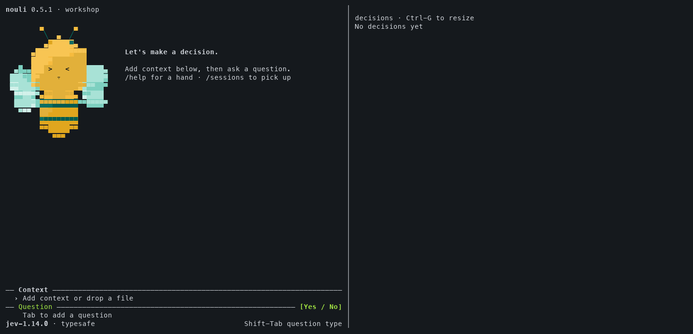

# Nouli

**The platform for decision networks.** Chain small AI decisions into big ones, and trace every step.

Nouli is a free, MIT-licensed terminal app, CLI and Rust library for building decision networks. Link the calls your team already makes, feed them facts from every source, and send each answer where it needs to go. You don't have to hand-roll the plumbing for every API.

[](https://github.com/nouli-ai/nouli/actions/workflows/ci.yml) [](https://github.com/nouli-ai/nouli/releases) [](LICENSE) [](rust-toolchain.toml)

[Website](https://nouli.ai/) · [Examples](https://nouli.ai/examples/) · [Guide](https://nouli.ai/guide/) · [Models](https://nouli.ai/models/)

[](https://nouli.ai/guide/#interactive)

*The Nouli 0.5.1 terminal app replaying the workshop network below at 3× speed.*

## Install

On macOS with Apple silicon:

```sh
brew install nouli-ai/tap/nouli
```

On Linux (ARM64 or x86_64, glibc 2.38+), or macOS without Homebrew:

```sh
curl -fsSL https://nouli.ai/install.sh | sh
```

The script installs `nouli` into `~/.local/bin`. Then connect a decision model and open the app:

```sh
nouli connect
nouli
```

`nouli connect` sets up TypeSafe, OpenAI, OpenRouter, Cloudflare Workers AI, Ollama, llama.cpp or any compatible endpoint. See [installation](docs/release.md) and [configuration](docs/configuration.md).

## Build your first network

This network plans a workshop. The brief branches into a venue decision and a program decision, and both blend into the final plan.

```sh
nouli new workshop \
  'Plan a step-free workshop for 60 people. Budget: 6000 USD.' \
  -q 'feasible: Can we plan this workshop?'

nouli new venue --from workshop \
  'Riverside Hall is step-free, fits 80 and costs 1200 USD. The Loft costs 900 USD but has stairs.' \
  -q 'venue: Which venue should we choose? [Riverside Hall, The Loft]'

nouli new program --from workshop \
  'Two speakers are available. Include breaks and useful hands-on time. The program costs 500 USD.' \
  -q 'program: Which program should we run? [Talks and practice, Talks only]'

nouli new plan --from venue --from program \
  'The venue and speakers can confirm today. Total event costs are 3500 USD, including lunch, materials and transport.' \
  -q 'confirm: Should we confirm the plan? [Confirm the plan, Revise the plan]'

nouli view plan
```

The venue and program steps each see the workshop brief and its answer. The plan sees everything from both. `nouli view plan` prints the graph, and `nouli context plan` shows exactly what the model was sent.

## How a decision network works

Each step is a small decision. It sees the facts and earlier answers it depends on, from every source.

- **Judgment goes to a decision model.** Ask a yes/no question, pick one of 2 to 255 options, or score against 2 to 10 ordered levels. The model returns a probability for each answer and writes no text.
- **Math, dates, lookups and routing stay in your code.** Run them between decisions, from any language through JSON or from Rust.
- **Every step is saved** with what it saw, what it answered and how sure it was. Find the step that went wrong, or send the unsure ones to a person.

| Operation | What it does | Command |
| --- | --- | --- |
| Chain | Add facts and ask the next question. Each step sees every answer before it. | `nouli add` |
| Branch | Test a what-if without touching the original. | `nouli new NAME --from SRC`, `nouli whatif` |
| Blend | Merge two or more histories into one decision. | `nouli new NAME --from A --from B` |
| Run | Save a network as a workflow and run ready steps in parallel. | `nouli workflow run FILE --parallel N` |

Workflows can route on typed answers with structured conditions, and `nouli workflow resume` reruns a stopped run without repeating finished steps. See [workflows](docs/cli-workflows.md) and [question syntax](docs/contracts/decisions.md#compact-question-syntax).

## Decision models

A decision model answers a question with fixed answers in one fast pass. That makes each call far cheaper than asking a frontier LLM, so a network of many small decisions stays affordable to run on every case. On TypeSafe Jev, a million decisions with 1,000-token inputs cost about $42.

Nouli works with any provider that speaks the `system-one` or `openai-decisions` protocol, including TypeSafe Jev and OpenAI Decisions, or a model on your own machine. Switch providers and keep your history.

## Open models from Nouli

We publish nine open-weight models on [Hugging Face](https://huggingface.co/nouli-ai). Five of the nine beat TypeSafe Jev 1.14.0 on their tasks in our held-out tests. Each model card covers setup, inputs and license.

| Model | Task |
| --- | --- |
| [Underwrite Evidence](https://huggingface.co/nouli-ai/nouli-underwrite-evidence) | Historical construction-incident evidence for underwriting review |
| [Cyber Specialists](https://huggingface.co/nouli-ai/nouli-cyber-specialists) | CVSS vulnerability triage and ATT&CK technique mapping |
| [Policy Pair](https://huggingface.co/nouli-ai/nouli-policy-pair) | Check case evidence against a written policy: TRUE, FALSE or UNKNOWN |
| [Clause](https://huggingface.co/nouli-ai/nouli-clause) | NDA evidence and a fixed checklist of 17 hypotheses |
| [Insurance Loss Event](https://huggingface.co/nouli-ai/nouli-insurance-loss-event) | Property-claim notices across 22 loss events, with an intake queue |
| [Route](https://huggingface.co/nouli-ai/nouli-route) | English banking requests across the 77 BANKING77 intents |
| [Push](https://huggingface.co/nouli-ai/nouli-push) | Actions for the PushT simulator from keypoints |
| [Doom](https://huggingface.co/nouli-ai/nouli-doom) | Actions for ViZDoom Deadly Corridor |
| [Guard](https://huggingface.co/nouli-ai/nouli-guard) | English hate-speech classification: no, unclear or yes |

See results and recorded examples in the [model catalog](https://nouli.ai/models/).

## Examples on real data

Each example runs a decision network on 100 to 300 real cases from a public dataset.

- [Vulnerability triage](https://nouli.ai/examples/vulnerability-triage/): score and route new CVEs from NVD.
- [Injury claim intake](https://nouli.ai/examples/injury-claims/): code OSHA injury reports, then route the claim.
- [Device incident reports](https://nouli.ai/examples/device-reports/): sort FDA MAUDE reports by what happened, what failed and who reviews it.
- [Safety report analysis](https://nouli.ai/examples/aviation-safety/): find what went wrong in NASA ASRS reports.
- [Contract review](https://nouli.ai/examples/contract-review/): check each CUAD clause, then sign, redline or escalate.

## Use it from scripts and agents

Add `--json`, `--jsonl` or `--format toon` for output your code can read:

```sh
nouli context plan --json
nouli sessions export plan --json
```

Pass a complete request file with `--input`, or embed the [Rust library](docs/embedding.md) in your application. Coding agents can start from the [agent reference](https://nouli.ai/llms.txt).

## Documentation

[User guide](https://nouli.ai/guide/) · [CLI reference](docs/cli.md) · [Configuration](docs/configuration.md) · [Output formats](docs/output.md) · [Rust embedding](docs/embedding.md) · [Architecture decisions](docs/adr/)

## Contributing

Use the pinned Rust toolchain and run:

```sh
cargo fmt --all --check
cargo clippy --workspace --all-targets --locked -- -D warnings
cargo test --workspace --locked
```

Tests use fixture providers and need no API keys. See the [repository conventions](AGENTS.md).

---

<sub>Your history stays on your machine under `~/.nouli`. Questions go only to the provider you choose, and `nouli context` shows what was sent. Providers charge for their API; local models run on your own hardware. Answers are model judgments and depend on the model you configure. The Jev cost uses November 2026 prices. Model results come from Nouli's held-out evaluations against Jev 1.14.0, and each model card states its validation scope. The CLI and Rust library are [MIT-licensed](LICENSE); model licenses vary.</sub>
