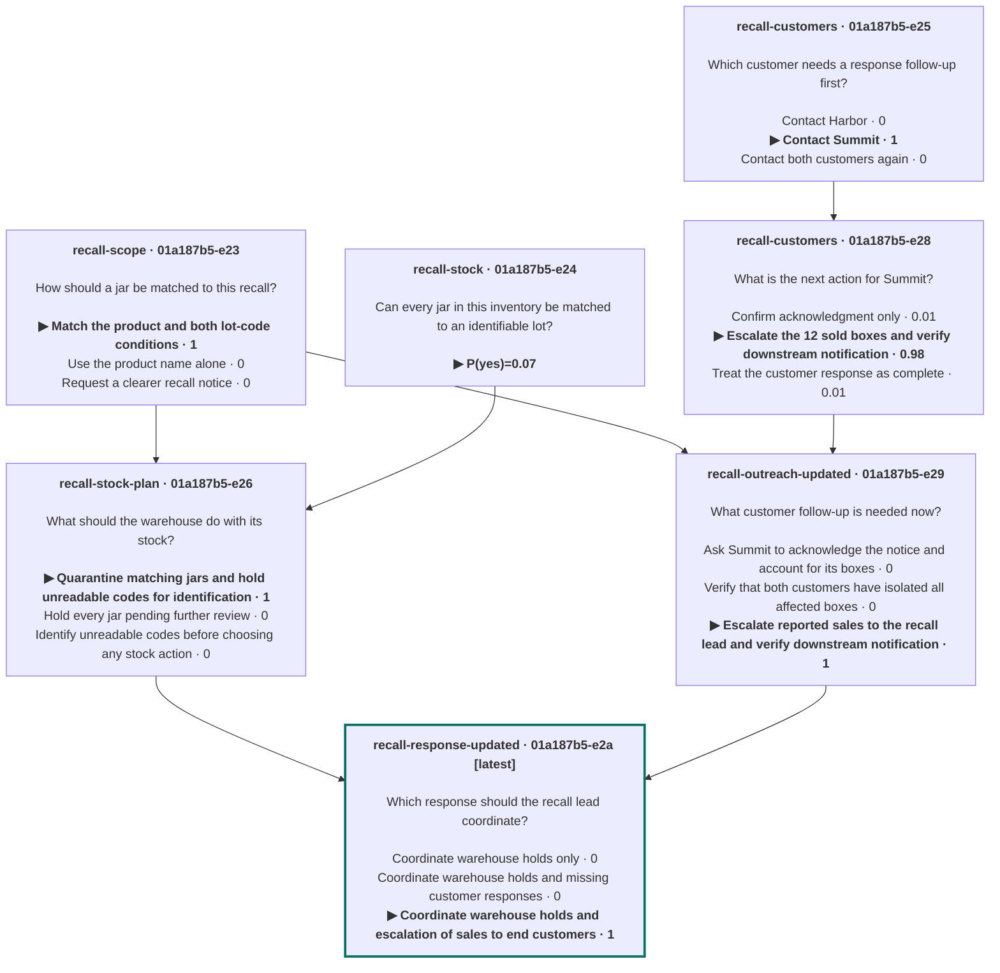

<h1></h1>

**Nouli is a ledger-backed decision network that records AI decisions and connects them to the facts and earlier answers they use.**

[Website: nouli.ai](https://nouli.ai/) · [User guide](https://nouli.ai/guide/) · [Examples](https://nouli.ai/examples/)

```sh
brew install standing-desks/tap/nouli
```

On Linux, or on macOS without Homebrew: `curl -fsSL https://standing-desks.github.io/nouli/install.sh | sh`. Then run `nouli connect` to choose a service, authenticate and select a model. You can also [write the configuration yourself](docs/configuration.md).

[](https://github.com/standing-desks/nouli/actions/workflows/ci.yml)
[](https://github.com/standing-desks/nouli/releases)
[](https://github.com/standing-desks/nouli/releases)
[](LICENSE)
[](rust-toolchain.toml)

### Give this to your agent

```text
Install Nouli, a CLI that runs decision models over many turns:
  curl -fsSL https://standing-desks.github.io/nouli/install.sh | sh
Read https://nouli.ai/llms.txt for the commands.
Help me define a provider in ~/.nouli/config.toml, then run
`nouli auth login typesafe` and let me type the key myself.
Ask each decision as one -q question per command, add only new facts
with `nouli add SESSION`, and read the answers from --json reports.
```

<sub>Works with any coding agent that can run a shell command. Every command in the prompt is documented in [docs/cli.md](docs/cli.md).</sub>

## What's a decision model?

A decision model doesn't write text. You give it facts and a question with a fixed set of answers, and it returns a probability for each answer. That makes it useful for real decisions, but each call is stateless: the model forgets everything once it answers.

## So what does Nouli add?

Nouli gives it a memory: a ledger that keeps every fact, question, and answer. When something changes you add only what is new and ask your next question, and the model answers it with the whole history in view. Sessions branch and blend, so one decision can build on several earlier ones. Each question is asked once, so earlier answers stay as they were. Nouli ships as a CLI and a Rust library.

## What does a decision graph look like?

The map at the top of this README is this example.

A food distributor handles a peanut butter recall. It keeps the recall scope, its warehouse stock, and its customers in separate sessions, then blends them into one coordinated response. When a customer reports that 12 affected boxes were already sold, it adds that one fact with a new question about it, and builds a revised response in new sessions, so the first response stays as it was decided. The new turn:

```sh
nouli add recall-customers \
  'Illustrative update at 11:00 on May 23, 2022: Summit has now acknowledged the
notice. It isolated 18 SNACK-A boxes and reports that 12 were already sold to
end customers. Whether those buyers have been notified is unknown. This
replaces the earlier Summit nonresponse. Harbor still has all 30 boxes
isolated.' \
  -q 'customers: What is the next action for Summit? [Confirm acknowledgment only,
    Escalate the 12 sold boxes and verify downstream notification,
    Treat the customer response as complete]'
```

```text
  turn 2 · 1 fact · 1 question
  customers     Confirm acknowledgment only      ▎                    0.01
              ▶ Escalate the 12 sold boxes and … ███████████████████▋ 0.98
                Treat the customer response as … ▎                    0.01
```

### What each decision was built on

A blend starts a session with the history of every session it names, so a blend of blends stands on everything behind both. The three blends behind the final response:

| Decision | Layer | Built on directly | Behind those | Answer |
| --- | --- | --- | --- | --- |
| `recall-stock-plan` | 1 | `recall-scope`, `recall-stock` | — | Quarantine matching jars and hold unreadable codes for identification · **1.00** |
| `recall-outreach-updated` | 1 | `recall-scope`, `recall-customers` turn 2 | `recall-customers` turn 1 | Escalate reported sales to the recall lead and verify downstream notification · **1.00** |
| `recall-response-updated` | 2 | `recall-stock-plan`, `recall-outreach-updated` | `recall-scope`, `recall-stock`, `recall-customers` turns 1 and 2 | Coordinate warehouse holds and escalation of sales to end customers · **1.00** |

<sub>Layers and inputs from `nouli view recall-response-updated`, answers as recorded. `recall-response-updated` stands on six earlier decisions: two directly, four behind them.</sub>

`nouli view recall-response-updated --mermaid` prints the whole history behind the final response, and GitHub draws it:



The [recall walkthrough](https://nouli.ai/examples/recall/) goes through every step, and more [examples](https://nouli.ai/examples/) cover robotic picking, seed investing, lending, credit limits, vulnerability response, and energy planning. Each one shows its steps at the prompt or as commands.

## What does a session look like?

`nouli open catalog` opens a session full screen. Add context, write a plain-text question, choose an answer type, and press Enter to send. Bare `nouli` and `/new` create a session with a unique name like `curie-7-diffraction`; explicit names still work. The simple `nouli` header shows the session; generated question IDs stay out of the transcript. No bracket syntax is needed in the form. Drag the divider to resize the graph at any time; Ctrl-G focuses it for keyboard scrolling. Click **select text** or press **F6**, drag normally, and use your terminal’s Copy command; **Esc** or **F6** resumes editing. The view stays still while copying and active requests continue in the background. The terminal’s selection modifier also works in normal mode (Option-drag in iTerm2), and arrows to move between fields. Referenced answers connect to the question using them, including across sessions and after reopening. Context previews the latest included question and answer history. Images display their filenames. Use `@` to find a file under the launch folder, or drop a file into the focused field. DOCX/PPTX text and tables, spreadsheets, CSV/TSV and SVG images are supported; PDF text needs Poppler and legacy DOC/PPT needs LibreOffice. Select a file to review it before sending; paste a list into Options to fill several options at once. The same session can also be driven through commands and piped input. The [simple meeting example](https://nouli.ai/examples/meeting/) shows three turns in one session. This current TUI capture replays its recorded travel answer:

```text
 nouli 0.4.0 · travel
travel › The train costs 40 USD and arrives 30 minutes before the meeting. A
taxi costs 70 USD and also arrives in time. Prefer the cheaper option that
arrives on time.
travel › How should I travel to the meeting?
  turn 1 · 1 fact · 1 question
   ▶ Take the train                   ████████████████████ 1.00
     Take a taxi                                           0.00


── Context · latest question included ──────────────────────────────────────────
  ↳ How should I travel to the meeting?
  › Add context or drop a file
── Question · Yes / No [Choose one] Score · Shift-Tab → ────────────────────────
    How should I travel to the meeting?
── Options · using previous 2 ──────────────────────────────────────────────────
  Press Enter to send
 typesafe/jev-1.14.0 · Ready
 Tab question · @ reference · ↑↓ fields · /help
```

- **Facts wait for a question.** Plain lines are facts. A `?` line sends them with the question as one turn.
- **Sessions combine.** `catalog` holds the item's grasp history and `policy` the station's rules. `/blend catalog policy as pick` starts `pick` with both, so its questions are answered with that history in view.
- **Each question is asked once, with its own options.** A `?` line asks only that question, in one call. Earlier answers stay as they were: the failed suction attempt shaped the answer to `next`, and `action` keeps the answer it had.

A question is one line: an ID, a colon, the prompt, then the answers. `[a, b]` makes a choice, `<low, medium, high>` makes a score with levels in order, and no list makes a yes/no question. `/replace N TEXT` corrects a fact and keeps the old text in history, `/branch NAME` starts a new session from this one, `/facts` and `/view` show what the session holds, and `/help` lists the rest. Ctrl-C on an empty prompt, or `/exit`, leaves.

The lines above are typed into the view's input row and appear in its transcript. Under it, a form holds the facts, the question, and its options, and the session's decisions are drawn beside it. Shift-Tab cycles left to right through yes/no, choice, and score from any field. Tab moves between fields and list items. In Options/Levels, Enter adds the next row and a second Enter sends. Typing `/` lists the commands, and `/sessions` resumes an earlier session. The selected answer type stays after sending. For choices and scores, an empty answer list reuses the prior options or levels with a visible notice; leave the question empty too to resend it with new information. Yes/No questions stay fresh. Citrus colors identify each type across the form and saved decisions. The [command-line guide](docs/cli.md#full-screen-view) lists the keys.

Type `@` in any field to reference an exact saved answer. Search question wording or IDs across **all sessions in your local store**, including decisions from other workspaces and workflows. Suggestions show the source session and turn; **Browse history** adds full answer previews. Enter inserts the reference, Ctrl-O inspects it, and the current draft keeps its type and answer list. Selected results and their saved image inputs remain available in subsequent decisions.

`@` also searches the plain text of saved conversations: context, structured values, options and answers. Matching excerpts explain the results. **Browse history** shows the selected answer's saved input state; PgUp/PgDn scroll it. Use `/rename NAME` to give the current session a new name while keeping its history and draft.

## Can a script or an agent drive it?

Everything you can do at the prompt is also a command. The `pick` session continues from a script, and each command adds the latest sensor report and asks the next question:

```text
$ nouli add pick 'Sensor update: the arm pinched the bottle neck, and pinch attempt 2 lifted the target. The wrist force sensor reads 1.9 kg against an expected 0.45 kg. The tote camera shows a second bottle stuck to the target by an adhesive strip on the bags.' \
    -q 'load: What should the arm do with the load? [Lower the load back into the tote and request remote assistance,
      Place the load in box B-12 and let the packer remove the extra bottle,
      "Shake the load to separate the bottles, then place the target"]'
  turn 3 · 1 fact · 1 question
  load        ▶ Lower the load back into the to… ████████████████████ 1.00
                Place the load in box B-12 and …                      0.00
                Shake the load to separate the …                      0.00
$ nouli add pick "Remote assistance, 40 seconds: the operator separated the bottles by marking pinch points, and the arm now holds only the target (0.46 kg). The operator reports that the target's bag is torn along one edge." \
    -q 'destination: Where should the arm put the target? [Send it to the exception station,
      Place it in box B-12,
      Return it to the tote]'
  turn 4 · 1 fact · 1 question
  destination ▶ Send it to the exception station ████████████████████ 1.00
                Place it in box B-12                                  0.00
                Return it to the tote                                 0.00
```

The answers match station rules that no command in `pick` repeats: a load more than 15% off its expected weight is never placed, and a torn bag goes to the exception station. Those rules are in `policy`, and `pick` inherited them along with the item's history. `nouli context pick` shows exactly what reached the model for a turn.

Every turn asks one `-q` question, in its own call. `nouli new NAME [FACT...] -q …` starts a session and `--from A --from B` blends sessions, `nouli ask pick -q …` asks without new facts, `--replace N TEXT` corrects fact N, `nouli whatif pick … -q …` asks without saving, `nouli facts pick` lists the numbered facts, and `nouli view pick` draws the session's decision graph. Every command takes `--json` for a versioned report, and `--input FILE` takes a complete request, so agents get the full contract. Answers depend on your model.

## How do I install it properly?

On **macOS (Apple silicon)**:

```sh
brew install standing-desks/tap/nouli
```

On **Linux**, or on macOS without Homebrew:

```sh
curl -fsSL https://standing-desks.github.io/nouli/install.sh | sh
```

The script installs into `~/.local/bin` after checking the download's checksum. Linux builds are for ARM64 and x86_64 and need glibc 2.38 or newer. See [installation and upgrades](docs/release.md) for choosing a version or directory and for switching from a Cargo installation.

Then define a provider in `~/.nouli/config.toml` ([how](https://standing-desks.github.io/nouli/guide/#provider)) and log in once. Nouli asks for the key without showing it and keeps it in a file only you can read:

```sh
nouli auth login typesafe
```

## Where's the rest?

- [User guide](https://standing-desks.github.io/nouli/guide/): setup, interactive mode, sessions, branching, blending, and workflows
- [Configuration](docs/configuration.md): providers, models, credentials (`nouli auth login`), and storage
- [CLI guide](docs/cli.md): the interactive prompt, sessions, facts, questions, request files, branching, and blending
- [Question types](docs/contracts/decisions.md): `choice`, `noul`, and `score`
- [Output formats](docs/output.md): text, JSON, JSONL, and TOON
- [Workflows](docs/cli-workflows.md): dependent decisions and resuming interrupted runs
- [Rust library](docs/embedding.md): embed Nouli in your own application

## How do I run the checks?

```sh
cargo fmt --all --check
cargo clippy --workspace --all-targets --locked -- -D warnings
cargo test --workspace --locked
```

Tests use local fixture providers and don't need API keys. The website lives in [`site/`](site/README.md). See [AGENTS.md](AGENTS.md) for conventions and [docs/adr/](docs/adr/) for design decisions.

## License

[MIT](LICENSE)
