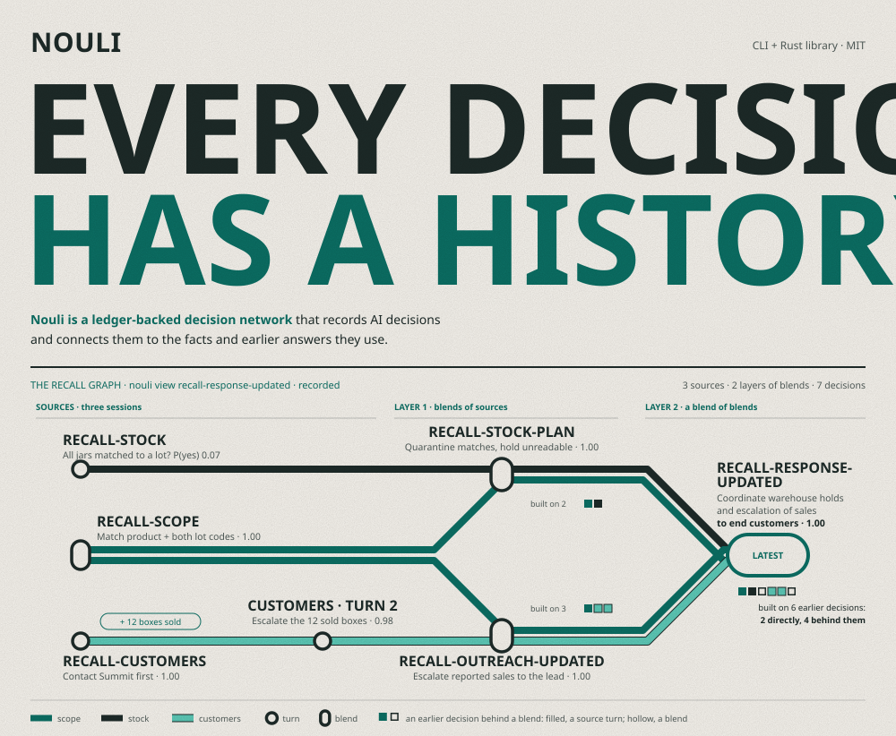
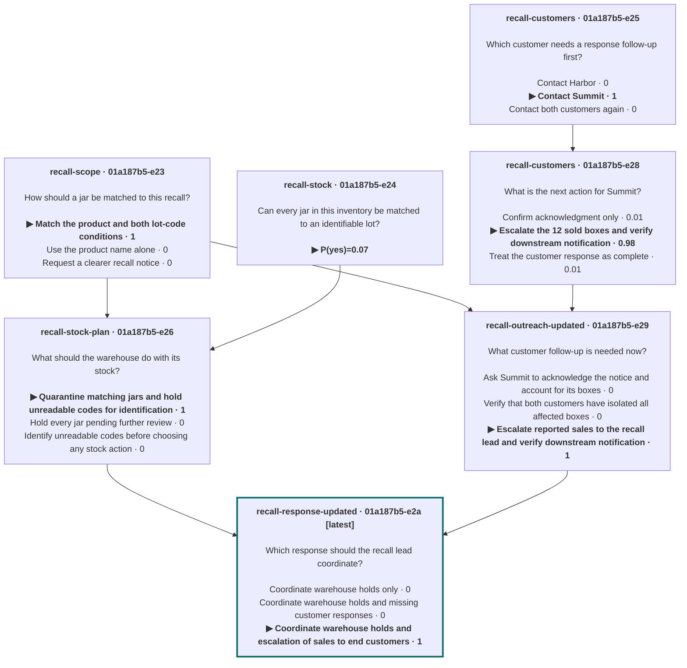

# Recorded recall decision graph

The diagram below is generated from the recorded Mermaid graph in this document.



A food distributor handles a peanut butter recall. It keeps the recall scope, its warehouse stock, and its customers in separate sessions, then blends them into one coordinated response. When a customer reports that 12 affected boxes were already sold, it adds that one fact with a new question about it, and builds a revised response in new sessions, so the first response stays as it was decided. The new turn:

```sh
nouli add recall-customers \
  'Illustrative update at 11:00 on May 23, 2022: Summit has now acknowledged the
notice. It isolated 18 SNACK-A boxes and reports that 12 were already sold to
end customers. Whether those buyers have been notified is unknown. This
replaces the earlier Summit nonresponse. Harbor still has all 30 boxes
isolated.' \
  -q 'customers: What is the next action for Summit? [Confirm acknowledgment only,
    Escalate the 12 sold boxes and verify downstream notification,
    Treat the customer response as complete]'
```

```text
  turn 2 · 1 fact · 1 question
  customers     Confirm acknowledgment only      ▎                    0.01
              ▶ Escalate the 12 sold boxes and … ███████████████████▋ 0.98
                Treat the customer response as … ▎                    0.01
```

### What each decision was built on

A blend starts a session with the history of every session it names, so a blend of blends stands on everything behind both. The three blends behind the final response:

| Decision | Layer | Built on directly | Behind those | Answer |
| --- | --- | --- | --- | --- |
| `recall-stock-plan` | 1 | `recall-scope`, `recall-stock` | None | Quarantine matching jars and hold unreadable codes for identification · **1.00** |
| `recall-outreach-updated` | 1 | `recall-scope`, `recall-customers` turn 2 | `recall-customers` turn 1 | Escalate reported sales to the recall lead and verify downstream notification · **1.00** |
| `recall-response-updated` | 2 | `recall-stock-plan`, `recall-outreach-updated` | `recall-scope`, `recall-stock`, `recall-customers` turns 1 and 2 | Coordinate warehouse holds and escalation of sales to end customers · **1.00** |

<sub>Layers and inputs from `nouli view recall-response-updated`, answers as recorded. `recall-response-updated` stands on six earlier decisions: two directly, four behind them.</sub>

`nouli view recall-response-updated --mermaid` prints the whole history behind the final response, and GitHub draws it:



The [recall walkthrough](https://nouli.ai/examples/recall/) goes through every step, and more [examples](https://nouli.ai/examples/) cover robotic picking, seed investing, lending, credit limits, vulnerability response, and energy planning. Each one shows its steps at the prompt or as commands.
